<div align="center"></div>
<h1 align="center">Soap Opera</h1>
<div align="center">


</div>


**Soap Opera** is a web-based **Laravel** laundry management system for running a laundry shop: taking orders at the counter, tracking payments and order status, and reporting daily and monthly sales.
It replaces paper job orders and notebooks with a **point of sale, order tracking, customer records, inventory and reports** in one place, and works on desktop, tablet and phone. It is built for touch screens at the counter: every control is sized for a finger, in a blue-and-white design with the bubble mascot.

> **Current version: v2.0.0** — a touch-first redesign of every screen except the sign-in page: a new point of sale (one tap per item, customer type-ahead, Repeat last order, a payment sheet with keypad, quick cash and change due), a dashboard of KPI tiles and a Needs attention center, order status tabs with bulk updates and saved views, a new **Ready for pickup** status, and one accessible design system (WCAG AA contrast, 44 px+ touch targets). See [docs/DESIGN.md](docs/DESIGN.md) for the UX audit, page blueprints and design system. Built on v1.3.0: discounts as a peso amount or a percentage, and restored backups brought up to the current database automatically. Built on v1.2.0: a flatter look around the bubble mascot (with arms, legs and facial expressions), a **Needs attention** panel on the dashboard and a daily automatic backup. Built on v1.1.0: the app is now **Soap Opera**, with a new blue-and-white bubble look on every page, a redesigned login page and dashboard, and a POS that groups services into sections by service type. Built on v1.0.0, the first stable release: real database backup and restore, correct order totals and payments, role-based access, faster pages and a mobile-friendly layout. See [Releases](https://github.com/nncast/laravel-laundry-management-system/releases) for the release notes.

<p align="center">
  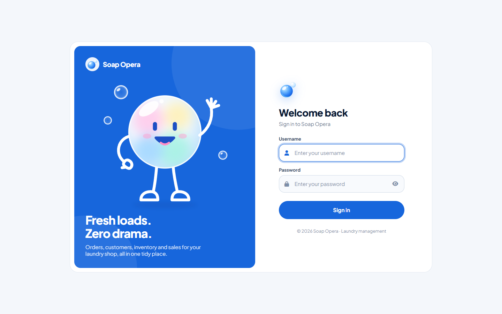
  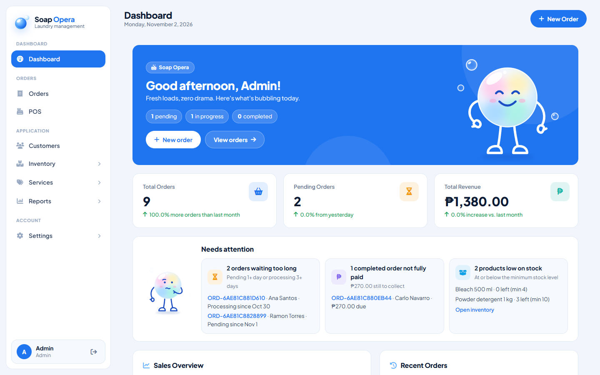
  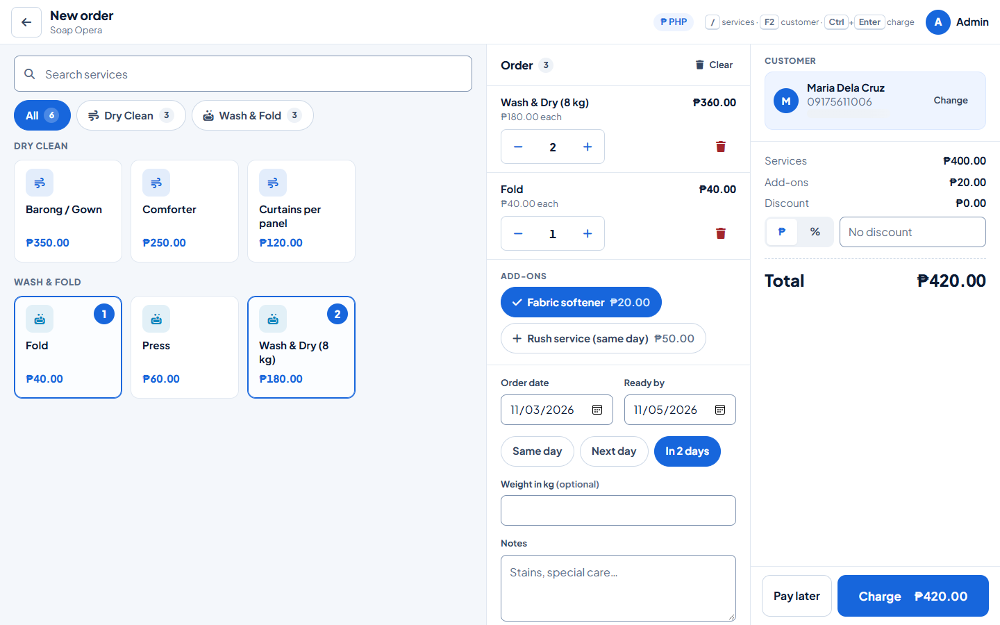
  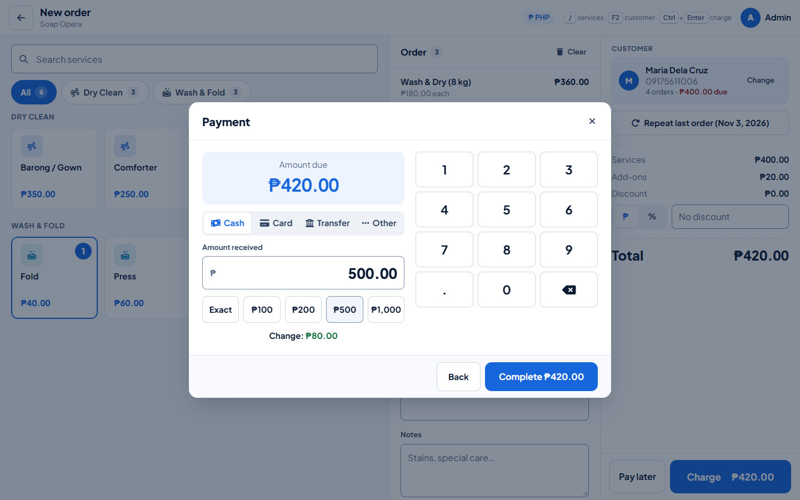
  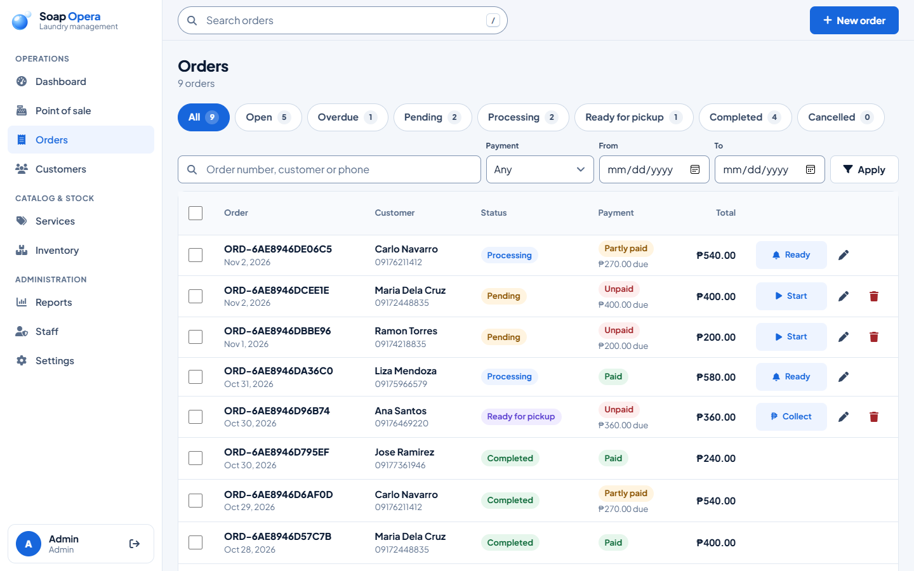
  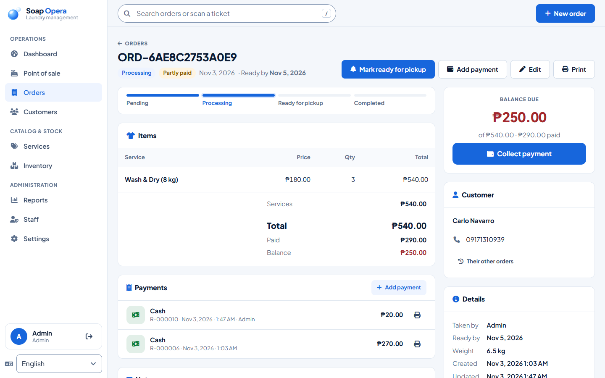
  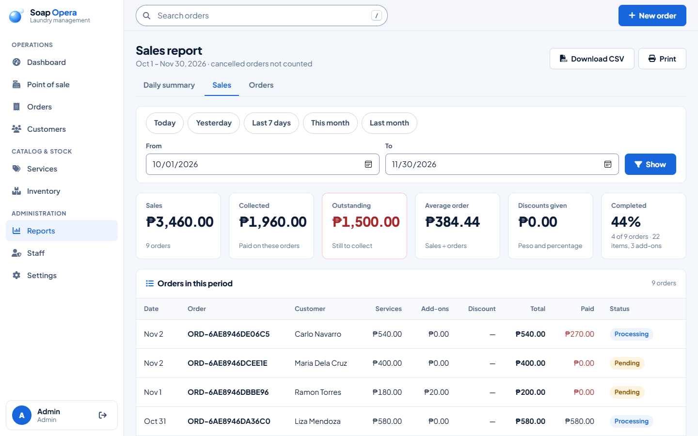
</p>

<p align="center">
  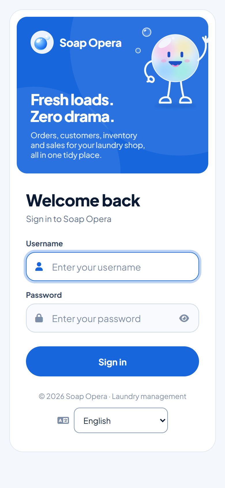
  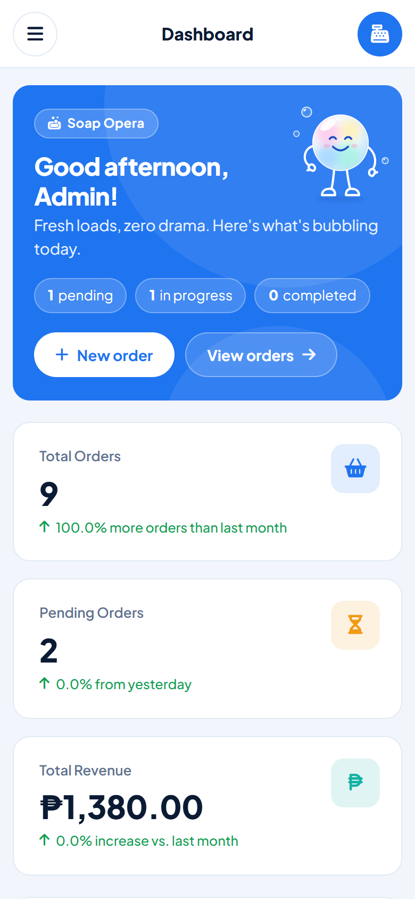
  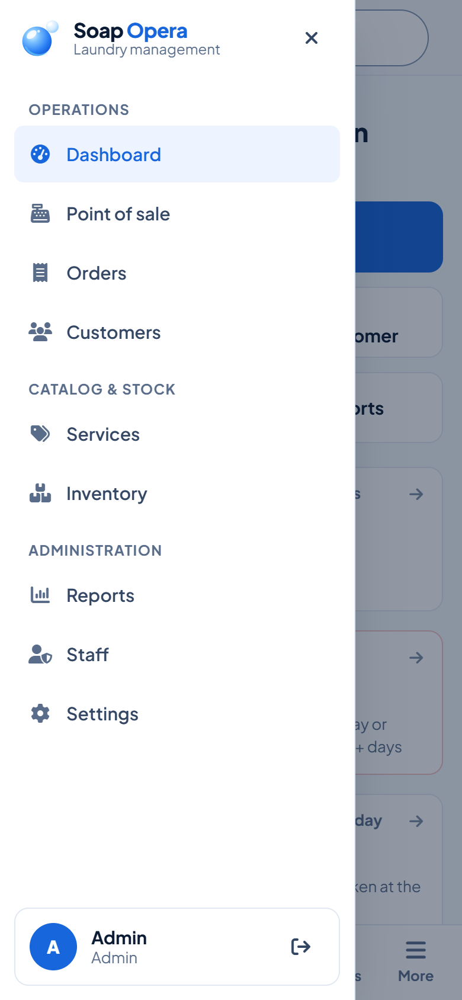
  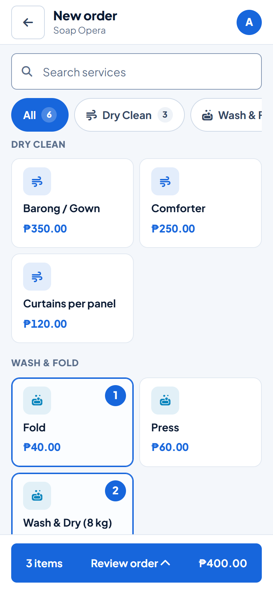
  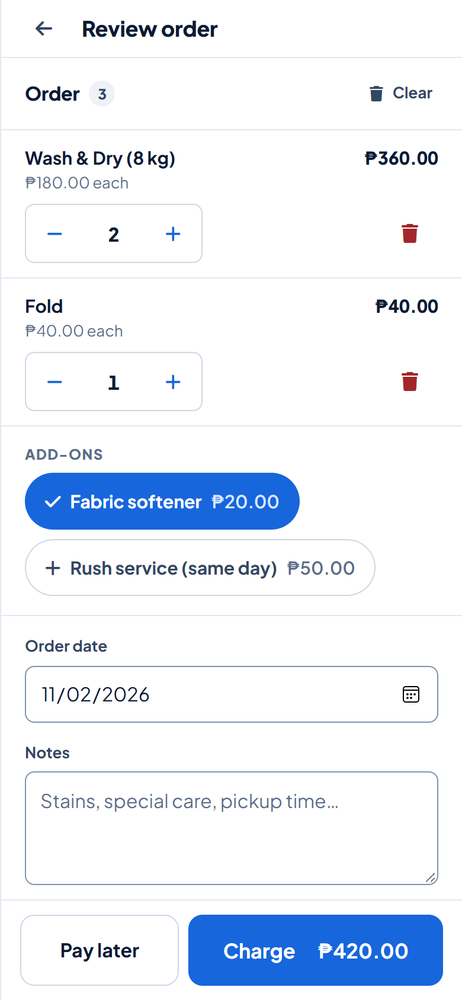
</p>

## Features

**Point of Sale** (built for touch screens)
- One tap adds a service; big steppers change amounts; add-ons are one-tap chips; Undo when removing
- Services grouped by type, with type chips and search (Enter adds the first match)
- Customer type-ahead by name or phone, recent customers, new customer without leaving the order, and **Repeat last order**
- Discounts as a peso amount or a percentage, with 5/10/15/20% shortcuts (the order keeps its percentage when edited)
- Payment sheet with cash, card, transfer or other, quick cash amounts, an on-screen keypad and the change due; **Pay later** for payment at pickup; only the amount owed is recorded
- Three panels on desktops, two on landscape tablets, and a slide-up order on phones; an unsaved order survives a page refresh

**Orders**
- Status flow: **Pending → Processing → Ready for pickup → Completed** (or Cancelled)
- Status tabs with counts, payment and date filters, saved views, one-tap next step and bulk status updates, all with Undo
- Order details with progress, payment history, a payment dialog with change due, notes, editing and a receipt printout

**Records**
- Customers with contact number and address, their number of orders, last visit and balance due
- Services (with price, type and icon), service types and add-ons
- Inventory: products, categories and units with stock levels
- Staff accounts with Admin, Manager and Cashier roles

**Reports**
- Dashboard KPI tiles (today's, active, ready and overdue orders; revenue today and this month; money collected today; unpaid balance), each opening the matching order list
- Weekly / monthly / yearly sales chart and top services
- Daily, Sales and Order reports with date presets and status filters
- CSV export (opens in Excel) and print

**Automations**
- **Needs attention** on the dashboard, checked on every visit: overdue orders (Pending 1+ day or Processing 3+ days), orders ready for pickup (with a one-tap **Picked up**), completed orders that are not fully paid, products at or below their minimum stock, and, for admins, whether backups are still being made
- **Daily automatic backup** without setting up cron: the first dashboard visit after a backup turns a day old makes a new one (kept with the last 10 in `storage/app/backups`); with a scheduler running (`php artisan schedule:work`) it also happens without anyone opening the app

**Settings & Backup**
- Business name, address, contact number and logo (favicon)
- One-click database backup (`.sql` file with all data)
- Restore from a backup, with an automatic safety backup taken first

## Roles

| Page | Cashier | Manager | Admin |
| --- | :---: | :---: | :---: |
| Dashboard, POS, Orders, Customers | ✓ | ✓ | ✓ |
| Delete orders and customers | | ✓ | ✓ |
| Inventory and Services | | ✓ | ✓ |
| Reports | | | ✓ |
| Staff, Settings, Backup & Restore | | | ✓ |

## Development environment

| Category | Details |
| --- | --- |
| Language | PHP 8.2+ |
| Framework | Laravel 12 |
| Front end | Blade templates, plain CSS and JavaScript (one design system: `public/css/app.css`, `public/js/app.js`), Font Awesome |
| Database | MySQL / MariaDB (XAMPP or Laragon) or SQLite |
| Tests | PHPUnit (`php artisan test`) |

## Requirements

| Tool | Download |
| --- | --- |
| PHP 8.2 or later (XAMPP 8.2+ or Laragon) | [XAMPP](https://www.apachefriends.org/download.html) · [Laragon](https://laragon.org/download/) |
| Composer | [getcomposer.org](https://getcomposer.org/download/) |
| MySQL / MariaDB (included in XAMPP and Laragon) | — |
| Git (optional, for cloning) | [git-scm.com](https://git-scm.com/downloads) |

> **Note:** Laravel 12 needs **PHP 8.2 or later**. Older XAMPP versions ship PHP 8.0 — check with `php -v`. Node.js / npm are **not** needed.

## Setup and run instructions

### 1. Start MySQL
- **XAMPP:** open the XAMPP Control Panel and start **MySQL**
- **Laragon:** click **Start All**

### 2. Clone the project
```bash
git clone https://github.com/nncast/laravel-laundry-management-system.git
cd laravel-laundry-management-system
```
Or download the [source .zip](https://github.com/nncast/laravel-laundry-management-system/archive/refs/tags/v2.0.0.zip) and extract it.

### 3. Install dependencies
```bash
composer install
```

### 4. Setup environment
```bash
# Windows (CMD)
copy .env.example .env

# Linux / macOS
cp .env.example .env
```

Generate app key:

```bash
php artisan key:generate
```

### 5. Configure database

Edit the `.env` file:
```env
DB_CONNECTION=mysql
DB_HOST=127.0.0.1
DB_PORT=3306
DB_DATABASE=laundry_system
DB_USERNAME=root
DB_PASSWORD=

APP_TIMEZONE=Asia/Manila
SESSION_DRIVER=file
CACHE_STORE=file
```

> Use `127.0.0.1`, not `localhost`. On Windows, `localhost` can add about a second to every page load.

<details>
<summary>Using SQLite instead of MySQL</summary>

Keep `DB_CONNECTION=sqlite` in `.env` and create an empty database file:

```bash
# Windows (CMD)
type nul > database\database.sqlite

# Linux / macOS
touch database/database.sqlite
```
</details>

### 6. Run migrations and seed

```bash
php artisan migrate --seed
```

If prompted with:

```bash
WARN  The database 'laundry_system' does not exist on the 'mysql' connection.

Would you like to create it? (yes/no) [yes]
```

Type:

```bash
yes
```

Then press `Enter`.

### 7. Start the app
```bash
php artisan serve
```

Open `http://localhost:8000` in your browser.

---

## Default Account

| Role | Username | Password |
|------|----------|----------|
| Admin | `admin` | `admin123` |

**Important:** change the default password after first login (**Staff**), and set your business name and logo under **Settings**.

## Backup & Restore

Go to **Settings → Backups**.

<p align="center">
  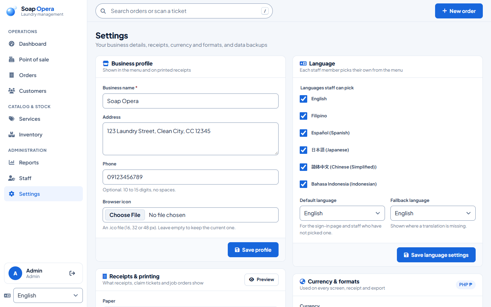
</p>

- **Download a backup** saves a `.sql` file with every table and record. Keep it somewhere safe (USB drive or cloud storage).
- **Automatic backups**: a copy is also saved to `storage/app/backups` once a day on its own (see Automations above), so the **Last backup** time stays recent even if nobody clicks the button. Copy them off the computer from time to time.
- **Restore backup** replaces all current data with a backup made by this system. A safety backup of the current data is saved to `storage/app/backups` first, and you are logged out afterwards.

## Upgrading

**From v1.x to v2.0.0:** pull or download the latest version, replace the files, then run `php artisan migrate`. It adds the **Ready for pickup** order status (and, coming from v1.2 or older, a column so a discount can be a percentage; existing orders keep their peso discounts). Your data, business name, address and logo are kept. If a page still looks like the old version, refresh it once more so the browser loads the new styles.

Restoring a backup made by an older version brings it up to the current database automatically.

**From 0.9.0:**

1. Download a backup from **Settings** first.
2. Pull or download the latest version, then run:
   ```bash
   composer install
   php artisan migrate
   ```
3. Add `APP_TIMEZONE=Asia/Manila` to your `.env`, and change `DB_HOST=localhost` to `DB_HOST=127.0.0.1` if you use MySQL.

The migration adds the payment method column, report indexes, the percentage-discount column and the Ready for pickup status, and recalculates the totals and paid amounts of existing orders that earlier versions saved incorrectly.

## Running tests

```bash
php artisan test
```

## Contributing

Contributions are welcome. Fork the repository, work on a branch from `main`, and open a pull request describing what changed and why. See [CONTRIBUTING.md](CONTRIBUTING.md) for the workflow and code style, and [AUTHORS.md](AUTHORS.md) for the people who built it.

## Security

Please don't report vulnerabilities in public issues. Use the repository's **Security → Report a vulnerability** tab instead. See [SECURITY.md](SECURITY.md) for details.

---

*Soap Opera · Laundry Management System · 2025 · Laravel 12 · PHP 8.2 · MySQL / SQLite*
